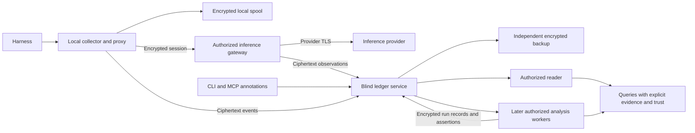

# Feature: kan v2 — a service for durable interaction evidence

## Summary

Make kan a self-hostable service that retains encrypted raw interaction evidence across machines and projects, with the same service running locally or remotely. A small authorized plaintext gateway forwards inference traffic; immutable evidence, explicit annotations, and later background extraction feed provenance-preserving query views. The first release proves capture, storage, retrieval, migration, and recovery; subsequent releases bring extraction and day's process assessment into the same system.

Status: architecture draft, 2026-10-16. This proposes a product architecture, not a change to the existing `kan-claim-v2` codec. Existing contracts remain authoritative until their explicit amendments are accepted.

## Requirements

- REQ-1: One service implementation and typed API serve loopback, a home server, and hosted deployments. Repository checkout discovery is optional client context, never the prerequisite for reading or recording evidence.
- REQ-2: A centralized service data root holds multiple governed scopes across projects and hosts. Project associations are attributed annotations; they neither define storage partitions nor implicitly grant access across scopes.
- REQ-3: Capture provider exchanges and harness-side activity through complementary adapters. Preserve original application payload bytes, stream order, errors, cancellation, tool activity, attachments, session lineage, and the adapter's explicit coverage limits.
- REQ-4: Immutable event identity distinguishes occurrences from identical content. Retransmission is idempotent; repeated inference attempts and differing observations remain distinguishable and attributable.
- REQ-5: Storage and backup principals receive encrypted content and declared metadata only. The personal-instance default retains rich operational metadata; an instance-level obfuscation profile can reduce disclosure. Content plaintext is confined to authorized collectors, the gateway, readers, and later analysis workers; their privileges are separately granted and auditable.
- REQ-6: Normal inference has a bounded capture path and no dependency on extraction, indexing, or process assessment. Remote capture outages use a bounded encrypted local spool with explicit pending status; when no durable capture medium remains usable, inference continues with an explicit recording-gap signal.
- REQ-7: Remote durable receipts are issued only after evidence and its committed manifest survive restart. Local-spooled, remote-durable, and independently-backed-up are separately observable states.
- REQ-8: Routine append, startup, and bounded reads do not load the lifetime archive. Memory and queue use are bounded by active concurrency, chunk limits, and requested page size; archive growth is addressed with incremental storage and indexes.
- REQ-9: Evidence, identity/control records, annotations, model-run outputs, and disposable projections have declared authority and lifecycle classes. Every implemented persistence owner must extend the existing surface-conformance discipline.
- REQ-10: Cryptographic validity, identity standing, scope admission, and consumer trust remain separate judgments. A collector's signature attests observation, not that a human or provider cryptographically authored the captured content.
- REQ-11: Preserve source and causal edges, contradictory observations, and explicit missing evidence. The query layer retains witness-based identity and relation semantics and exposes its selection, snapshot, projection version, and trust frame.
- REQ-12: The storage MVP includes authenticated append, exact retrieval, paginated discovery, annotations, exports, restore, health, and legacy import. It works without an analysis provider or workflow engine.
- REQ-13: Subsequent extraction produces immutable, attributable run records and outputs tied to exact evidence spans, prompts, schemas, model identities, and execution parameters. New runs coexist; they do not overwrite prior interpretation or manufacture determinism.
- REQ-14: Jev-like decision models are replaceable analysis adapters for bounded classification, routing, and segmentation decisions. Model-specific semantics never become the ledger format or the only path to retrieving evidence.
- REQ-15: Integrate day into the future kan product while keeping process policies and assessment scheduling separate from storage and inference forwarding. Background assessment is attributable evidence and has no automatic authority to perform external actions.
- REQ-16: Recovery uses an explicit committed backup checkpoint and independently recoverable keys. A clean host must restore acknowledged evidence up to that checkpoint, control history, annotations, and source identifiers without the original checkout or service database.
- REQ-17: Import released logs without rewriting original signed claim bytes, CIDs, authorship, or identities. Unknown future records are preserved. Failed import never replaces or destroys the source.
- REQ-18: Extend existing identity, scope, URI, fold, and ATProto work through explicit compatibility boundaries. A new central deployment or a new project label must not silently rename a scope or change what an old URI identifies.
- REQ-19: Retain captured payloads indefinitely until explicit owner-controlled erasure. Erasure is a storage-access operation distinct from semantic retraction. Missing payloads remain disclosed; a summary never substitutes for evidence that was deleted, unavailable, or never captured.
- REQ-20: Storage qualification includes crash injection, incomplete streams, retries, corrupt objects, lost acknowledgments, long archives, concurrent hosts, and a recovery drill. Proposed performance envelopes are measured before becoming a release promise.
- REQ-21: Ship a local migration tool with the storage MVP that discovers existing kan repositories beneath user-selected filesystem roots, previews an inventory and destination mapping, and imports selected stores into the aggregate v2 service through its normal encrypted ingest API. Imports must be resumable, bounded in memory, non-destructive, and independently verifiable, including when the old CLI cannot read a store because of size limits or a narrowed trust view.

## Acceptance Criteria

All criteria below are **implementation intent**, not claims that tests exist or pass. Each names a proposed witness to implement and bind to a resolvable test citation during the corresponding milestone. The document linter checks the design's structure, not these runtime properties.

- [ ] AC-1: Intent; witness `deployment_equivalence`: the same service build accepts an identical fixture corpus through loopback and remote endpoints and returns equivalent evidence IDs and typed judgments, with different deployment provenance disclosed. (REQ-1)
- [ ] AC-2: Intent; witness `cross_project_scope_isolation`: capture two projects and a session with no checkout, query an authorized cross-project view, and prove a third unauthorized scope contributes neither content nor semantic index results. Moving a checkout changes no evidence ID. (REQ-2)
- [ ] AC-3: Intent; witness `capture_coverage_matrix`: a reference harness fixture includes user input, tools, subagent events, compaction, attachment bytes, streaming chunks, and cancellation; each item is retained byte-exactly or listed as unavailable with a reason. The same suite reports what a proxy-only run cannot see. (REQ-3)
- [ ] AC-4: Intent; witness `occurrence_and_retry_identity`: upload one event repeatedly to obtain one occurrence; submit identical bytes in two distinct attempts to obtain two occurrences; reuse an event key with different bytes to obtain a conflict without replacement. (REQ-4)
- [ ] AC-5: Intent; witness `blind_store_canary`: seed unique plaintext canaries in bodies, semantic names, prompts, and query results; storage and backup credentials expose none in objects, indexes, logs, or crash artifacts. Enumerate the operational metadata visible under each profile. Gateway credentials cannot decrypt arbitrary historical objects. (REQ-5)
- [ ] AC-6: Intent; witness `degraded_capture_forwarding`: interrupt storage and analysis independently, verify bounded buffering and explicit pending status, drain after recovery without replaying provider requests, and exhaust all capture spools while proving inference continues and capture health reports a gap. (REQ-6)
- [ ] AC-7: Intent; witness `receipt_crash_matrix`: kill the service before and after every persistence/receipt boundary; every remote-durable receipt resolves after restart, retries converge, and orphan staging data cannot appear committed. A remote receipt alone never reports backup completion. (REQ-7)
- [ ] AC-8: Intent; witness `bounded_archive_io`: on 10 GiB and 100 GiB fixture archives with fixed active concurrency and page sizes, ordinary append/open/range-read paths perform no full-history scan and remain within the declared memory envelope; publish bytes read, RSS, and latency distributions. (REQ-8, REQ-20)
- [ ] AC-9: Intent; witness `v2_surface_conformance`: fail on any persisted field with no authority/lifecycle row, any uncatalogued writer, or any deterministic cache differing from recomputation over its pinned evidence. (REQ-9)
- [ ] AC-10: Intent; witness `observer_is_not_speaker`: an authentic capture of a spoofed role field remains collector-authored observation, and valid-but-unadmitted annotations remain inspectable without affecting admitted fold state. (REQ-10)
- [ ] AC-11: Intent; witness `snapshot_and_witness_replay`: change arrival order and index layout while fixing evidence membership and trust inputs; deterministic views agree, preserve contradictory witnesses and gaps, and change only when a declared input changes. (REQ-11)
- [ ] AC-12: Intent; witness `storage_only_install`: from a fresh host with no model credentials, capture/import a fixture, attach an annotation, page and retrieve it, export it, restart, and restore it successfully. (REQ-12)
- [ ] AC-13: Intent; witness `extraction_lineage_replay`: two different model outputs for the same evidence remain distinct retained runs; citations resolve to exact spans; deterministic reconstruction uses recorded outputs without rerunning a model. (REQ-13)
- [ ] AC-14: Intent; witness `decision_adapter_substitution`: a recorded Jev response and an alternative classifier response populate the same run contract without changing source events, and a missing/retired model cannot block historical reads. (REQ-14)
- [ ] AC-15: Intent; witness `assessment_is_not_execution`: a background day-style assessment cites its policy, declared target, and evidence; injected instructions in captured content cannot authorize new jobs, change access grants, or send external messages. (REQ-15)
- [ ] AC-16: Intent; witness `bare_host_restore`: restore the last verified checkpoint on a clean host using the independent key package; enumerate every committed event and dependency, rebuild projections, and show the exact uncovered interval after the checkpoint. Missing keys or objects fail visibly. (REQ-16)
- [ ] AC-17: Intent; witness `legacy_import_idempotence`: import a mixed released/current/unknown corpus twice, compare original bytes and CIDs, preserve source mappings and counts, inject corruption, and verify source files remain untouched. (REQ-17)
- [ ] AC-18: Intent; witness `uri_scope_continuity`: resolve old claim/scope fixtures before and after import; existing targets and four judgments agree, while new capture resources require explicit versioned URI semantics rather than overloading an existing resource. (REQ-18)
- [ ] AC-19: Intent; witness `erasure_without_false_retraction`: prove time alone never expires a payload, erase an owner-selected capture and affected managed derivatives, and exercise restore/index rebuild; the subject remains, erased evidence is disclosed, no semantic retraction is inferred, and restoration applies current erasure history before exposing evidence. Report backup purge separately; do not claim cryptographic irrecoverability from older backups and recovery keys. Policy is resolved in §10; the implementation remains required. (REQ-19)
- [ ] AC-20: Intent; witness `multi_host_fault_campaign`: two collectors upload offline histories, duplicate chunks, forks, tampered ciphertext, truncated streams, and ambiguous provider attempts; committed evidence is retained, incompleteness is explicit, and no uncertain provider request is automatically executed again. (REQ-4, REQ-7, REQ-20)
- [ ] AC-21: Intent; witness `local_migration_inventory`: discover a fixture tree with ordinary repositories, linked worktrees, separate stores in two checkouts of one project, a publication-only tree, an inaccessible directory, and a broken path. Preview names every discovered source and failure, performs no upload or source mutation, and does not merge stores merely because their Git remote or directory name matches. (REQ-21)
- [ ] AC-22: Intent; witness `aggregate_import_resume`: import multiple snapshots, interrupt between batches, lose a receipt, restart, and rerun against a moved source directory. The destination contains one retained copy of each identical signed record within its permitted deduplication domain, all source-occurrence links, distinct legacy-local subject namespaces, and an explicit report of pending or conflicting records. No source bytes change. (REQ-17, REQ-21)
- [ ] AC-23: Intent; witness `migration_without_legacy_cli`: import an archive larger than the old CLI's readable limit and a corpus containing valid but view-excluded claims with the old CLI unavailable. Bounded reads preserve every inventoried record, original bytes and judgments, opaque unsupported evidence, and explicit corruption reports; neither display filtering nor a disposable cache decides what exists. (REQ-8, REQ-10, REQ-21)
- [ ] AC-24: Intent; witness `migration_cutover_and_restore`: append to a source during inventory, require a stable snapshot or report retry, import a later delta, verify destination evidence and independent backup coverage, then explicitly switch client routing. A cutover failure leaves the old client configuration and sources usable; restore on a clean host reproduces the imported source mappings and claim bytes. Private signing keys and unrelated filesystem content are absent from the uploaded corpus. (REQ-16, REQ-17, REQ-18, REQ-21)

## Architecture

### 1. Why the service becomes the center

The desired unit of operation is a person's or team's retained knowledge across hosts and activities. A Git repository is an important association and publication boundary, but it is neither the natural lifetime nor the necessary owner of every conversation. A home server should be able to collect from several machines, be backed up as one managed service, and support later synthesis without depending on a particular checkout surviving.

Today's `src/workspace.rs` discovers repository-local state; `src/store/log.rs` opens a CAR into `MemoryStorage`; `src/transport/mod.rs` transports claims through a local-log-shaped abstraction. These are unsuitable as the raw-traffic hot path without substantial change. Incremental CAR append already exists, but opening and recovering the store still operate over archive bytes in memory. Raising a size limit does not resolve this architectural coupling.

The user reports a 10 MB cap; this session has not reproduced that particular failure. An uncommitted change in the original checkout addresses a 100 MiB dependency memory ceiling. These are separate observations, not proof of one root cause. V2's requirement is bounded operation across an archive much larger than memory, independently of which ceiling caused the reported incident.

The design serves the recorded raw-data-and-projections and performance-at-scale teloi, and preserves the identity-system-redesigned and uri-resolution-interoperable goals. The maintenance telos deliberately has no witnesses; a historical passing artifact cannot prove ongoing retention. Runtime conformance belongs in continuing checks.

### 2. Deployment and trust boundaries



The diagram shows logical principals, not a requirement for seven deployed services. MVP deployment is one small service package with a blind storage process and a separately credentialed gateway/reader process, plus lightweight client collectors. Both processes can run on the same home server. A local installation runs that same package against loopback and a machine-level data root. Client configuration associates working directories with endpoint/scope preferences; no knowledge archive lives inside the checkout.

The server being primary means its receipt is the normal durability authority and it owns the archive lifecycle. It does not mean one machine is the sole copy, that server observations replace source authorship, or that all data becomes one undifferentiated access domain.

| Principal | Plaintext available | Credential boundary |
|---|---|---|
| Collector | Harness content it observes; its pending spool when unlocked | Its signing key, scoped ingest grant, archive encryption public keys, gateway session keys |
| Gateway | Active provider requests/responses and operational routing | Short-lived session capability, provider credentials, archive encryption public keys; no general historical read key |
| Ledger/storage | Opaque identifiers, ciphertext lengths, arrivals, admission/routing metadata under the selected policy | Storage/receipt key and append authorization; no payload-decryption keys |
| Authorized reader | Granted history and its own query results | Explicit read/decryption grants; isolated index key |
| Analysis worker, later | Selected evidence necessary for a granted job | Bounded scope/job capability; results encryption key; separately approved model egress |
| Backup destination | Ciphertext, checkpoint and backup metadata | Backup object access; no plaintext recovery keys |

Metadata disclosure is an instance setting. The default personal profile favors observability: arrival times, sizes, service cursors, collector/host routing identities, failures, latency, and usage accounting may be visible where explicitly catalogued. Bodies, semantic annotations, prompts, and query content stay encrypted for the blind store; the authorized reader can expose richer semantic views. A field-level metadata inventory must say what each process and backup destination sees. A future obfuscated profile can hide selected fields and add padding/batching; its name must not imply timing/volume protection until independently tested. This explicitly revises the earlier universal metadata-hiding requirement. Obfuscation is non-default and need not delay the personal-instance storage MVP.

Application encryption terminates at the explicitly trusted gateway; provider TLS is a separate hop. The provider receives plaintext by design. This is end-to-end protection from collector to authorized gateway and encrypted archival storage, not a claim that the gateway or a root administrator of its host cannot read active content. Ordinary process/container separation reduces accidental access; it is not confidential computing.

Keep the plaintext kernel small: authenticate an explicit session, decrypt a bounded frame, forward with narrowly scoped provider credentials, observe the response, encrypt it for retention and delivery, and clear buffers as feasible. No summarizer, plugin runtime, arbitrary user code, or archive-wide query engine belongs in that kernel. Provider adaptation, framing, crypto, credential handling, and diagnostics are part of its audited attack surface. A later attested execution profile can strengthen the boundary without changing event semantics; no attestation guarantee is claimed for MVP.

Use established authenticated-encryption and key-wrapping constructions through audited libraries. The protocol follow-up must fix canonical bytes, domain separation, key purposes, authenticated routing context, freshness, algorithm negotiation, and independent valid/invalid vectors before implementation. Signing keys and archive encryption keys are distinct; do not mechanically copy the older seed-derived-key proposal into the newer RFC 1 identity model.

An archive scope has encryption epochs and independently recoverable wrapped epoch keys. Collectors and the gateway can encrypt new objects without receiving general archive-decryption access. Reader grants determine who can unwrap historical epochs. Removing a reader can prevent future epoch access but cannot recall plaintext or keys already acquired. The key package must be recoverable independently of the server disk. Key custody, selective erasure, and rotation granularity remain Q4.

### 3. Capture boundary: proxy plus harness adapters

A proxy can retain bytes that traverse it. It cannot reconstruct local tools never submitted to a provider, hidden harness state, unavailable attachments, or internal provider computation. Therefore "capture everything" is a coverage goal expressed through two adapters:

1. The provider adapter preserves request bodies, response bodies/chunks, applicable transport status, provider request identifiers, errors, cancellations, and request-attempt correlations.
2. The harness adapter supplies user-visible messages, tool invocation/result events, session and subagent lineage, compaction events, local model activity, attachments, and relevant configuration snapshots through supported hooks or explicit transcript ingestion.

Each adapter emits a versioned coverage descriptor: what it can observe, what it did observe, what it intentionally excludes, and when continuity is uncertain. Imported transcripts are marked imports; they cannot claim contemporaneous capture. An observed empty tool result differs from a tool result the adapter cannot access.

"Raw" means original captured application payload bytes, before normalization. It does not mean packet capture, hidden reasoning, or secret transport credentials. Authorization headers, cookies, and provider API keys stay in the credential path and are not archived. User content can contain sensitive material, so original bodies are encrypted. Any content redaction is explicit and records that the original was not retained; it cannot be described as lossless capture.

Large or binary content is streamed into bounded chunks. A URL is not a retained attachment: fetching bytes, permission to fetch, source, time, and digest are separate facts. Preserve original bytes alongside disposable parsing and normalized message projections. Unknown provider fields remain in the original payload even when a parser cannot interpret them.

The first integration must identify a real harness/provider pair and test supported hooks, streaming, and endpoint configuration. No broad transparent compatibility claim is made before that spike. Other adapters can follow independently because their output contract is the ledger event, not a particular provider schema.

### 4. The evidence model

Keep occurrence, content, observation, assertion, and projection distinct:

| Object | Identity and content | Authority |
|---|---|---|
| Payload | Immutable byte sequence, internal plaintext digest, encrypted chunk references | Evidence bytes; a digest proves correspondence, not truth |
| Capture event | Version, collector principal and identity state, stream incarnation, sequence, predecessor, capture time, event kind, payload references, causal links, coverage | Collector-signed assertion that it observed these bytes |
| Gateway event | Attempt/session references, observed provider exchange, gateway identity | Independent gateway observation, not a provider signature |
| Commit receipt | Opaque event/object commitments, scope routing token, service position, durable boundary, service signature | Service attestation of accepted durability |
| Annotation | Signed author, admitted scope, event/span/subject targets, body, citations | Deliberate assertion by its author |
| Extraction run | Immutable input manifest, recipe, request/response evidence, execution identity, outputs, completion state | Attributable computation/assessment evidence |
| Query projection | Exact source manifest, admission/trust frame, parser/fold versions, selected result | Disposable deterministic interpretation of those inputs |

Define an event occurrence by collector, stream incarnation, and monotone local sequence, bound to its immutable envelope digest. Identical content in two attempts has two occurrences and may share payload storage only inside an authorized deduplication domain. Network retransmission retains the original envelope and ciphertext. Reuse of an occurrence key with different content is a conflict, never a replacement. Restoring a collector starts a new stream incarnation rather than risking sequence reuse.

Sign canonical event content including payload digests and links. Encrypt the signed envelope and payload; keep plaintext CIDs inside that encrypted boundary. Outer storage identifiers are opaque ciphertext commitments or randomized identifiers; do not expose deterministic plaintext hashes that permit equality tests across scopes. The exact wire encoding and identity codec are a follow-up contract; the existing claim codec is not silently enlarged with raw traffic.

A capture's embedded "role: user" is source data. It does not acquire a human signature because a collector signed the observation. Keep claimed speaker, observer, provider endpoint, host, and importer separately attributed. `src/identity.rs`, `src/identity/authorship.rs`, and `src/claim/view.rs` already supply useful distinctions for this boundary.

Ordering has three meanings: producer-local sequence, explicit causal edges, and service arrival position. Wall-clock time is supplementary. A service cursor enables paging and checkpointing; it must not settle semantic conflicts or impose causal order on concurrent actors. Keep partial streams, divergent histories, late arrivals, and contradictory observations available.

Span references pin an event ID, payload digest, and byte interval or a versioned structured selector with a byte mapping. A tokenizer's token positions alone are not permanent citations. Segmentation manifests name exact members and offsets; a later boundary proposal creates a new manifest.

### 5. Storage engine and commit protocol

Proposed MVP storage is an append-only framed ledger of encrypted envelopes plus immutable encrypted payload chunks on local durable storage, with SQLite as a bounded metadata/index/coordination implementation. The ledger and committed manifests carry the authoritative evidence. SQLite tables that cache offsets, cursors, or search results remain rebuildable; any operational state that is authoritative must itself be retained as explicit control events. This deliberately retains `docs/SPEC.md` §10.1's authority distinction while changing the physical substrate.

Use one serialized commit owner per service storage partition, not one writable database copied among hosts. Many collectors and readers can operate concurrently. An initial single-node home server needs no distributed consensus, federation, or active-active database. If a shared filesystem or multi-node backend is later introduced, it must satisfy the same persistence contract independently. SQLite's WAL documentation requires cooperating processes on the same host and describes its single-writer behavior; this supports the proposed one-owner deployment, not an inference that SQLite automatically solves backup or durability. [SQLite WAL](https://www.sqlite.org/wal.html)

The commit protocol is:

1. Authenticate the uploader and validate its bounded outer admission capability. Validate framing, ciphertext hashes, quotas, and occurrence commitments. Semantic payload validation occurs in an authorized reader; blind storage cannot certify hidden claim contents.
2. Stream chunks to unique staging objects. Verify ciphertext length/digest and install them immutably with the storage backend's documented durable-write operation.
3. Append a framed commit manifest referencing only installed objects, its predecessor, occurrence commitments, and service position. Flush the ledger to its durable boundary. Seal and rotate segments at a bounded target size; never rewrite all previous segments on append.
4. Update the disposable metadata projection. If this fails after the ledger is durable, recovery replays the committed suffix; do not report the evidence as lost or execute the provider request again.
5. Return the signed durable receipt. Retried ingest locates the same committed occurrence even if the earlier reply was lost.

A manifest is the visibility boundary: chunks without a committed manifest are staging/orphan data, and a manifest with missing chunks is corruption. Torn tail frames can be quarantined and recovered; they cannot justify truncating any acknowledged prefix. Checkpoint catalogs and indexes allow routine startup to validate the checkpoint and bounded tail. Full verification/reindexing is an explicit streaming operation, not a hidden precondition of every query.

The metadata database cannot store conversation titles, text, semantic tags, plaintext digests, or embeddings under the blind storage principal. Authorized semantic indexes belong to the reader/worker boundary and are encrypted with its own key. For MVP, prefer bounded exact reads over eager full-history semantic indexing. At-rest encryption must cover index files, WAL/temp files, backups, and diagnostic paths; filesystem encryption alone does not make a process with the mounted key blind.

Proposed measurement envelope: 1 MiB payload chunks, 64 MiB ledger segments, 16 concurrent capture streams, and a 512 MiB storage-process memory budget, excluding separately budgeted plaintext readers and operating-system page cache. These are initial benchmark parameters, not measured capacity claims. Sweep payload sizes and concurrency, report disk I/O and queue depth, and tune before freezing defaults. Request/frame limits constrain an operation; they must never become a lifetime archive limit.

The alternatives remain explicit: retain CAR/MST as the internal store; put payloads in a database; use an external object store as primary storage; or require a distributed log. CAR/MST remains useful for import/export and ATProto interoperability, but the present all-memory read path is a poor baseline for traffic retention. Separate chunks keep large binary data off the metadata hot path. External object storage is a later interchangeable backend after its commit/visibility behavior is tested. A distributed log adds operational cost before the single-server use case needs it.

### 6. Forwarding, durability, and degraded operation

Normal request path: collector assigns attempt and event IDs, encrypts and durably spools the request, then opens an authenticated encrypted session to the gateway. The gateway captures its own receipt/forwarding events and streams to the selected provider. Storage ingestion proceeds independently under the bounded policy. Collector-spooled durability and server durability are reported separately.

Normal response path: the gateway captures provider bytes in order, encrypts chunks for archive and client delivery, and uses a bounded encrypted spool when the ledger is temporarily unavailable. In the durability-preserving profile it releases response chunks after a durable copy exists in the gateway spool or ledger. Group commit introduces a configurable bounded delay; it is measured, not described as zero-cost. An explicitly selected best-effort profile can forward sooner but cannot claim that every delivered byte was durably captured.

```text
observed -> locally_spooled -> remote_committed -> backup_checkpointed
    |              |                  |
    +-> gap        +-> pending        +-> backup_pending

provider attempt: prepared -> sent -> streaming -> completed
                                  \-> failed / cancelled / outcome_unknown
```

The service and provider cannot share an atomic transaction. A crash after forwarding can leave the provider outcome unknown. Distinguish request intent, forward attempt, provider acknowledgment when present, observed response, and terminal capture state. Retry evidence upload freely; never turn that into an automatic retry of inference. Provider idempotency, if supported, is adapter-specific and must not be assumed.

When the remote ledger fails but the gateway works, use its bounded encrypted spool. When the gateway itself is unreachable, the local collector can forward directly only if the deployment has explicitly configured local provider credentials and authorized that route; otherwise it reports gateway unavailability. Every fallback records which route was used. Offline storage does not conjure provider connectivity or credentials.

If both storage and relevant spools are exhausted, inference continues with a visible recording-gap signal, as the user selected. This also overrides the normal response-durability wait: the gateway reports degraded capture and keeps forwarding while the provider route remains available. Recording a gap during a complete storage failure is necessarily best effort: signal it immediately, retain it where possible, and report uncertain coverage on restart. Never promise exact knowledge of events lost before any durable observation. The capture indicator is available in CLI/service health and adapter-supported UI or telemetry; do not inject bytes into a provider response stream and break protocol compatibility.

Persist spool high-water marks, pending bytes, oldest pending event age, and last acknowledged receipt without content leakage. Evict only acknowledged items under policy; reserve enough space for control/gap records where possible. Recovery drains existing events, not provider requests. A collector can remain offline and upload later without obtaining a new event identity.

### 7. Queries, annotations, and categorical continuity

The same logical API supports CLI, MCP, and future clients. Conceptual operations are append evidence, retrieve immutable evidence, list a bounded scope snapshot, append an annotation, inspect coverage/durability, export a checkpoint, and restore it. These are design operations, not claims that CLI verbs already exist. Discovery and authenticated mutation remain separate from read URI identity.

`src/uri.rs` and `src/uri/local.rs` provide the current typed resolution seam. Preserve target identity, immutable replay selection, source provenance, admission, and trust while changing the backend from workspace files to a configured service. Keep existing URI grammar valid. New capture/session/run resources require a versioned extension with conformance vectors; do not invent a resource spelling and imply RFC 2 already accepts it.

Project views are queries over attributed associations. A session may span projects; a personal scope may contain many projects; a collaborative project may have its own governed scope. A cross-project query enumerates authorized input scopes and pins their snapshot vector. It does not require one global total order. Derived outputs combining scopes inherit a reader set no broader than the intersection of their inputs unless a separate explicit publication/redaction action authorizes broader release.

Carry forward `src/fold/identity.rs`, `src/fold/state.rs`, `src/fold/relations.rs`, and `src/fold/claim_view.rs` as semantic reference implementations. Preserve directed attributed witnesses, selectable enrichment, identity-before-state, contested outcomes, and flattening at presentation. Session similarity, shared text, and a model's cluster label are evidence for a proposed relationship; none silently becomes SameAs.

A useful abstract query is a deterministic function of evidence snapshot, retained assertions, normalization version, relation providers, admission policy, trust base, and rendering policy. Cache keys name all relevant inputs. A query result carries its input frontier, exclusions, coverage, pagination state, and unresolved citations. Completeness is relative to that declared captured set, never "everything that happened" or the entire network.

Explicit annotations may target an event, span, session, existing subject, or selected evidence set. The CLI/MCP client or an explicitly authorized annotation service signs and encrypts the annotation before submitting it to blind storage; the ledger endpoint never needs its plaintext body. A tag can request additional analysis by producing a durable trigger event, interpreted by an authorized scheduler. It does not synchronously invoke a model in the append transaction. Future indexed queries may be fast, but persisted projections do not gain authority merely because they are convenient.

### 8. Background extraction and the day merger

This is deliberately outside the first storage release, but the evidence model makes it possible without another archive migration:

1. Deterministic normalizers expose bounded source spans while retaining original bytes.
2. A segmenter proposes memberships and boundaries using structural hints and optional classifier results.
3. Typed classifiers attach decision distributions to exact candidate spans.
4. Generative extractors create summaries, proposed decisions, unresolved questions, and other documentation with source citations.
5. Process assessors compare retained evidence against explicit policies, targets, and process definitions.
6. Deterministic views combine recorded outputs under a chosen trust policy.

Each job names an immutable input manifest, recipe digest, requested model/version, returned model identity, parameters, schema, executing principal, grants, and causal trigger. Store full request/response evidence under the same confidentiality policy, plus usage and timing where available. Missing provider version details are explicitly unknown, never fabricated. A recipe change or a re-run produces a new run. A deduplication key can avoid duplicate job scheduling, but does not imply deterministic model output or exactly-once provider execution.

Jobs are at-least-once with durable attempts, leases, retry policy, and terminal states. Publication is idempotent by run/output identity. Recovery can observe ambiguous attempts without inventing their results. Triggers carry origin and causal depth so analysis output does not recursively schedule unlimited analysis. Work quotas and priorities reserve capture capacity; readers and workers cannot starve ingestion.

Keep raw evidence and prompts as data, not control instructions. A classifier can propose a tag or assessment; it cannot grant itself data access, activate a workflow, or authorize external side effects. Automatic derived assertions may appear under a named extractor trust frame. Whether they participate in a user's default decision/status view requires an explicit policy, left open in Q5.

The user's requested merger deliberately revises ADR-18 and `CLAUDE.md`'s kan/day product boundary. The eventual product owns storage, durable background jobs, policy definitions, and process assessment together. Internally, retain separate modules and privilege boundaries: the storage engine does not need to understand a telos or decide when a review should happen. Existing day atoms, teloi, and assessments migrate as attributed records; current day remains usable during transition. MVP neither rewrites day nor installs a replacement workflow engine.

### 9. Jev's specific role

Checked against primary TypeSafe sources on 2026-10-16. Jev accepts state and typed questions, returning choices, rubric scores, and probability judgments. That is suitable for bounded questions such as "does this span record a decision?", "does the topic change at this candidate boundary?", or "which of these supplied task labels fits?" It does not supply a general prose-summary primitive. [TypeSafe introduction](https://docs.typesafe.ai/introduction)

The current model documentation lists Jev 1.13.0 and 1.14.0, a price of $0.042 per million input tokens, and default limits of 64k tokens per request and 32k per question. Aliases can move; pin a model for evaluation and retain the returned identity. These are vendor-published interface/pricing facts, not measured kan workload performance. [TypeSafe models](https://docs.typesafe.ai/models)

The October 14 release also introduces experimental multimodal and longer-context options. They are unnecessary for the first segmentation experiment; preserve multimodal raw evidence regardless of classifier support. [Jev 1.14 announcement](https://typesafe.ai/blog/jev-1-14)

Proposed use: generate candidate boundaries deterministically from messages, tool spans, and bounded windows; ask Jev narrow questions about those candidates; retain all returned distributions; use a versioned deterministic policy to choose a segmentation; send selected spans to a separate generative summarizer. Require explicit uncertain/none outcomes and retain alternative memberships when warranted. A low-confidence boundary must not cause source content to disappear.

Before choosing Jev operationally, compare it against structural heuristics and another adapter on a user-approved trace corpus: boundary precision/recall, missed decisions, source-span fidelity, uncertainty behavior, actual token cost, and latency. Provider-based classification is another plaintext disclosure requiring an explicit worker egress grant. This session made no inference calls and uploaded no traces. Compatibility with FunctionGemma is not assumed from the analogy.

### 10. Backup, recovery, and erasure

Backblaze is a requested backup destination; this design specifies the provider-neutral checkpoint contract, not an unverified product configuration. A backup consists of an immutable checkpoint manifest, all referenced ciphertext objects and ledger segments, signed control history, codec metadata, and an independently recoverable encrypted key package. Authentication secrets for live providers are separately reprovisioned and are not conversation evidence.

A checkpoint advances only after the backup worker has verified the complete referenced object closure at the destination. Backup high-water position and age are visible independently from the service's durable position. A server can correctly acknowledge data that has not yet reached independent backup; losing that server before the next checkpoint loses the uncovered interval. State that interval explicitly instead of promising zero data loss.

A restore starts on a clean host, verifies the checkpoint and ciphertext closure, obtains recovery keys independently, validates signatures and control history, rebuilds indexes, and compares receipt coverage. Maintain a locally retained or separately witnessed checkpoint/receipt to detect a server presenting an older history. A wholly lost set of witnesses cannot prove a host did not omit its newest records; the guarantee is bounded by the checkpoint actually available.

Back up committed manifests with their object closure, not an arbitrary copy of a live database file. Regular restore drills are part of acceptance, including corrupted objects and a missing-key failure. Specify recovery time and backup-lag objectives from measured deployment data before release; no numerical recovery promise is established here.

The logical ledger retains subjects and provenance. Retain payloads indefinitely by default, until explicit owner erasure; storage pressure is an operational condition, not permission to expire history. Retraction changes a view; erasure removes access to retained payload material.

**Owner decision, 2026-10-20:** granularity and irrecoverability are separate choices.
The normal erasure unit is a logical capture (a request/response exchange including
its chunks and attachments), with explicit bulk selection for sessions or archives.
An encryption epoch is not the normal selection boundary: its shared key may cover
unrelated captures. A preview resolves the logical selection into exact retained
objects and affected copies/derivatives; a partial discovery window cannot claim
to enumerate a complete capture.

The v2 contract is removal from managed Kan plus prevention of resurrection through
managed restore. It does **not** promise that old backups plus old recovery
credentials become cryptographically unable to recover content. Per-capture
cryptographic erasure is a separate future custody design, not a prerequisite for
this contract and not something epoch rotation or ordinary wrapped-key backups
already provide.

The owner authorizes a concrete preview. Its durable signed erasure record retains
minimal identifiers, attribution and disposition, never a copy of the erased body
or a free-text excerpt. The ledger retains provenance and displays “erased by
owner,” distinct from accidental missing/corrupt evidence and semantic retraction.
The coordinated plan covers raw payloads, replicas, pending spools, indexes,
normalized caches, excerpts, analysis inputs/outputs and summaries containing the
material. Known lineage drives a conservative cascade; incomplete dependency
knowledge must be disclosed, not treated as proof that no derivatives exist.
Independent assertions or subjects are not semantically retracted by this cleanup.

Completion is reported per destination: managed removal completed, pending purge,
or outside Kan's control. Backups and recovery-key packages are listed explicitly.
An acknowledged erasure must fence reads, retries, ingest replay, index rebuild and
derived publication before asynchronous cleanup can report completion. Interrupted
cleanup resumes from the signed authorization and cannot report a merely queued
job as completed.

A managed restore remains quarantined until it has validated and applied the
current independently retained erasure history, including erasures newer than the
backup. Restoring only the old backup's own erasure state is insufficient. If the
current history or an adequate trusted checkpoint is unavailable, the restore
cannot claim the no-resurrection guarantee or expose the restored evidence.
As with receipt witnesses, loss of all independent erasure witnesses limits what
can be proven; the UI must state that limitation.

Removing live bytes does not prove removal from filesystem snapshots, old backups,
distributed plaintext, or copied keys. Strong cryptographic erasure would require
removal of every recoverable relevant key copy, including wrapped copies; shared
epoch-key deletion would also sacrifice unrelated captures. Backup purge status
therefore stays separate from managed erasure status. No production erasure is
authorized by this architecture decision.

#### Large selections: consent is independent of execution batches

The complete logical selection must not have to fit in one HTTP request, owner
journal row or native storage-erasure record. Discovery retains authenticated
coordinate pages and verifies capture closure before offering approval. The
reviewable preview binds the configured destinations, capture identities, verified
archive frontier, recording-gap disclosure, object/byte totals and a digest of
all ordered selection pages. The owner can inspect the pages; the approval submits
that retained reference and digest rather than echoing a large authority payload.
No partial discovery or client-supplied coordinate list becomes an authority.

After approval, retain owner-signed consent to that exact selection and durable
progress. Prepare bounded native issuer/owner erasure records from those selected
coordinates, journal each exact authorization before publishing custody, and
resume across crashes or lost acknowledgements. Existing native record-size limits
are batch limits. Current metadata must still match the approved objects; later
appends are outside a frozen selection. Legitimate intervening custody changes may
require fresh chain coordinates, but never expand the approved object set. Already
erased targets count only when verified current custody names the exact coordinates.
Missing selection pages or custody fail closed, with an incomplete job remaining
visible. No payload body is copied into consent or progress records.

Dependent publication/workspace cleanup uses the union of the approved source
coordinates, including approved targets already erased before resumption. It must
not lose lineage by treating each batch as an unrelated user decision. Completion
requires every selected source batch plus the configured copy/derivative scope to
reconcile. The same manifest mechanism supports explicit multi-capture selection
and owner-selected archive prefixes; session labels remain evidence associations,
not implicit deletion authority. Existing inline single-capture jobs remain
resumable under their original contracts. The integration branch now implements
this manifest, consent, bounded worker and explicit bulk-selection path in the
shared owner API and Library. Runtime qualification remains pending CI; this is
not a release or a claim of constant-memory discovery.

#### Scale qualification still outstanding

Source inspection at integration commit `31fa5f1` contradicts completion of REQ-8 /
AC-8. `src/evidence_store/attested.rs` runs `verify_for` from ordinary admission;
that calls `Ledger::verify_contents` and `audit_prefix_cached`. The latter still
walks the retained prefix and reads/hashes current payloads. Its bounded cache
memoizes exact-byte cryptographic verification, not archive membership or payload
availability. `Archive::open` also calls the full verifier. In
`src/evidence_store/inventory.rs`, startup explicitly audits the entire metadata
chain before servicing bounded pages. Streaming these scans bounds some memory
but does not make I/O independent of lifetime archive size.

The passing 11 MiB / 179-occurrence workload therefore proves capture/retrieval
beyond the original reported ceiling; it does not prove the 10 GiB / 100 GiB
acceptance criterion. The measured roughly threefold fixture preparation speedup
is not evidence that routine append/open/range-read has the required complexity.
This remains implementation work before full-v2 completion, followed by remote
scale measurements. No large local build or dataset is authorized by this note.

The next storage implementation must separate explicit whole-archive maintenance
verification from normal serving while retaining authenticated membership,
current custody and exact selected-byte verification. A fast path must not simply
trust an unauthenticated index, file timestamp, or archived freshness claim. It
must define how committed frontiers and indexed membership survive restart,
concurrent writers, missing/corrupt payloads, restored old stores and erasure.
Any added persisted frontier/index/proof changes require the surface catalog and
protocol compatibility contract to change with the implementation. Existing strict
owner verification/recovery APIs remain available as explicit maintenance work;
no current integrity guarantee may disappear behind a silently changed method.

Qualification must measure ordinary operations at both declared archive sizes and
also mutate old/current metadata, payloads and checkpoints, exercising restart and
stale restore. A bounded result may report unavailable/corrupt selected evidence;
it must not label an unscanned archive globally verified. The accepted target stays
unchanged; a new cache hit count or a smaller passing workload cannot close AC-8.

#### Seekable payload layout

New archives use a rowid `objects` table with a separate unique CID index. This
keeps the lookup key separate from a potentially damaged large payload cell;
length/type inspection and bounded substring reads use a CID seek followed by the
rowid rather than scanning every object. Record fields, ciphertext CIDs, native
proofs and logical profile numbers are unchanged. Strict schema validation accepts
exactly this layout or the historical `WITHOUT ROWID` layout; unknown alternatives
remain errors. Ordinary legacy readers retain their existing safe bounded-memory
scan. Indexed proof/source readers require the seekable layout and report that
requirement explicitly. Existing owner recovery builds a separate archive with the
current layout and preserves the original; no live file is silently converted.

Indexed inventory startup checks a signed current checkpoint and selected prefix
membership. Every page occurrence is authenticated against the same root, including
caller-selected continuation coordinates. Payload sampling verifies only selected
bytes and checks erased-object membership from the current signed custody map.
Fresh source reads reopen current state and reject changed custody before returning
bytes. They retain existing duration, cancellation, item and byte budgets. These
are selected-evidence claims, never a whole-archive audit claim.

#### Authenticated serving-index implementation contract

The bounded-serving work uses a separate content-addressed binary Patricia map;
`src/mst/` remains unchanged because its canonical rebuild currently walks all keys.
The new pure codec is `src/evidence_index.rs`. Its root authenticates map contents
only when bound to an independently validated service checkpoint. It is neither a
source-event identifier nor a replacement for archive, custody or scope authority.
No new capture URI or reinterpretation of old claim/receipt bytes follows from it.

Keys are SHA-256 over the versioned key domain, a length-framed namespace and an
opaque coordinate. Values are bounded metadata commitments, never captured content
or semantic names. Leaves encode a 32-byte key and a bounded value; branch nodes
encode the first differing bit, a canonical shared prefix and two child hashes.
Nodes use a separate versioned hash domain. Reads authenticate each traversed node
and validate increasing branch depths and child prefixes. Missing, oversized,
malformed or hash-mismatched nodes fail; they do not turn into absence. Insertion
rewrites one path, preserving prior roots. At most 257 existing nodes are read for
a 256-bit key, independent of corpus size. A returned new root is published only
after every new node write succeeds; failed writes can leave unreachable blocks,
but cannot change the caller's accepted root.

The initial codec has no filesystem writer or service activation. Its independent
Python reference rebuilds canonical trees from sorted key sets, while Rust updates
one path; shared vectors and insertion-order comparisons check agreement. Fault
checks cover missing nodes, byte substitution, invalid prefixes/depths, bounded
lookup work and interrupted writes preserving the accepted root. These establish
only the map primitive, not bounded archive operation or production index custody.

Before wiring serving paths, add a signed checkpoint binding archive/profile,
verified frontier and exact index root, with index blocks/checkpoint committed in
the same transaction as evidence and receipts. Verify requested source metadata
and payloads against that root; authenticate writer/operation/slot lookups before
using them for admission. Existing archives need explicit verified initialization
or rebuild; missing index state must report that work, never silently scan history
in a nominally bounded request. Inventory, copied archives, erasure/custody,
backup/recovery and independent freshness checks must all use the same contract.
The first durable integration is `evidence_store::serving`: an explicit full-audit
initialization/rebuild creates `serving_nodes` and a signed `serving_checkpoint` in
one immediate transaction. Checkpoints bind version, admitted/copied profile, archive,
scope, issuer, full frontier, map root, accepted native erasure tip and its highest required archive sequence. The map
commits exact sequence/manifest/receipt/proof metadata plus operation, writer-head
and slot coordinates, plus erased-object commitments. Normal admissions into initialized archives advance the
nodes/checkpoint atomically with evidence and attestation; exact retries preserve
the existing checkpoint. Rebuild replaces disposable nodes only after verifying
source data, under the same writer transaction. Failed rebuilds preserve the prior
checkpoint. Optional index tables are recognized by strict archive/inventory schema
checks; legacy archives remain readable and require explicit initialization for
the new read API.

`read_metadata` requires an independently accepted frontier and current custody tip,
authenticates the signed checkpoint and selected path, then verifies the selected
native attestation. Its result certifies selected metadata only. Missing or corrupt
payloads elsewhere do not turn that result into a whole-archive health claim.
Changed custody makes an older checkpoint unusable until refreshed by verified
maintenance. Owner erasure workers now refresh initialized maps after native
reconciliation, including root batches, replicas and publication archives. The
refresh verifies the native custody extension and unchanged authenticated metadata
frontier, then publishes new erased-object commitments atomically; it neither
rebuilds the source metadata map nor rescans lifetime payloads. Archives without
an index remain unindexed. A checkpoint loaded from the archive alone
cannot establish freshness. Copied checkpoints additionally bind the exact recipe
digest and whether its original metadata prefix has completed. Explicit rebuild
verifies that recipe against retained metadata; resumable copy batches advance
records, recipe status and the map atomically. Later current-issuer admissions
retain the copy commitment. Reading an earlier pin reports recipe completion only
when that pin contains the whole planned prefix. Selected source bytes are freshly
checked; the completion bit is not a claim that every imported payload is present.
No original request, receipt, proof or recipe is rewritten by index initialization.
The copied storage API also offers `open_indexed` / `admit_indexed`; admission
requires authenticated completed-copy state and rechecks its exact recipe under
the writer transaction. Incomplete imports remain browsable but cannot accept a
new native append. Full copy/recovery audits remain explicit maintenance paths.

The explicit `Archive::open_indexed` / `admit_indexed` storage path checks the
signed checkpoint, exact database tip, and caller-supplied current erasure custody
without auditing lifetime data. Staging checks erased-object membership against
the authenticated map. The existing commit transaction remains the visibility
boundary: before acceptance, indexed admission validates operation identity,
writer position/predecessor and slot commitments against the prior root, rechecks
checkpoint/custody under the writer lease, and advances the root with the receipt
and native proof. Unauthenticated SQL lookup changes cannot authorize a writer
fork. Interrupted operations retain both the prior proof/index or both new ones;
exact retries retain prior receipts/proofs. Unselected historical damage remains
visible to full audit and selected reads, rather than forcing a lifetime scan on
append. The original `open` / `admit` methods still perform full audits. Indexed
storage is available through explicit `rebuild-serving-index` and
`serve-admitted --indexed`; it is not the default. The HTTP admitting service
retains grant/policy checks and the independently current owner-custody lease
through indexed admission. Its existing real encrypted-spool delivery test now
exercises indexed ingestion. `serve-proof --indexed` connects bounded authenticated
inventory/source reads for both archive profiles to the unchanged Library wire
protocol. It requires the seekable payload layout described above. The external
owner-custody and policy readers still scan their independent control histories;
the option is not a claim that the whole deployment is bounded yet. Scale and
whole-deployment qualification remain required.

### 11. Compatibility and explicit departures

| Existing boundary | Retain | Proposed change |
|---|---|---|
| `docs/SPEC.md` §10 and `src/store/log.rs` | Append-only evidence, content addressing, verifiability | Raw encrypted event ledger/chunks replace CAR as the normal service hot path |
| `src/workspace.rs` | Optional Git context and source attribution | Central service data root replaces repository-local ownership of the archive |
| `src/claim/codec.rs` and `src/claim/compat.rs` | Byte-exact legacy/current/future coexistence | Event envelopes are a separately versioned format; annotations retain claim compatibility |
| `src/identity.rs` and RFC 1 | Principals, scopes, delegation, four judgments | Collectors, gateway, and workers become distinct service principals |
| `src/uri.rs`, RFC 2 | Resource identity, typed reads, replay snapshots | Local resolver uses the same service backend; capture resources need an explicit extension |
| `src/fold/` | Witnesses, trust-selected views, pure deterministic folds | Raw events and recorded extraction assertions supply additional attributed inputs |
| `tests/fixtures/read-write-surface.tsv` and `tests/surface_conformance.rs` | Exhaustive raw/derived catalog and recomputation checks | Extend ownership to ledger, chunks, spools, grants, jobs, backup checkpoints, and reader indexes |
| ADR-18 and day separation | Attributed process definitions and assessments | Merge product capabilities after the storage MVP, retaining internal privilege separation |
| Whole-CAR padded backup design | Blind content storage and explicit threat model | Live streaming and incremental objects, rich operational metadata by default, optional instance-level obfuscation |
| RFC 3 / ATProto | Explicit publication, portable semantics, existing claims | Publication is a later adapter over selected assertions; private raw traffic is never automatically published |

A local install must remain dramatically simpler operationally than a multi-actor installation: one owner, one service data root, loopback access, no federation, no remote synchronization protocol required. It shares the server implementation rather than carrying a second storage engine. Existing files remain readable during migration; clients must not silently initialize a new empty service when a configured endpoint is unavailable.

Migration is read-only discovery, inventory and verification, streaming import, ID-preserving comparison, then explicit client cutover. Preserve exact legacy bytes and distinguish duplicate carrier copies from original occurrence evidence. Import failure leaves the old installation intact. A global completeness check records sources, supported/unsupported counts, missing blocks, and unresolved identities; a partially imported corpus cannot be labeled complete.

Repository scope IDs remain stable. Mapping an old repository into a project view is a new association, not a rewrite of signed scope identity. A new personal scope can span projects without annexing their old governed scopes. Keep legacy read tooling and exports available until restore and compatibility qualification pass.

### 11.1. Local migration tool: existing repositories into one archive

The storage MVP includes a first-class migration tool, rather than requiring a script per repository. Here "v1 repositories" means the pre-service product's stores, which may contain both the released v1 claim codec and the newer identity-era claim codec. Import is additive into the configured local or remote v2 service. Aggregation does not flatten governed scopes or overwrite the old installation.

The proposed command family is `kan migrate` with discover, preview, import, status, verify, and cutover operations. This is proposed v2 syntax, not an existing CLI contract. The workflow is:

1. **Discover locally.** Search explicit directories or configured workspace roots for kan stores and publication trees, recognize Git directories and linked-worktree Git files, and allow an explicit store path without a checkout. Do not crawl the whole filesystem or follow arbitrary symlinks by default. Report permission errors, broken links, and excluded roots separately from an empty search result. Two aliases of one physical store are one candidate with multiple locators; two independent stores remain separate even if their remote, author, or project name matches.
2. **Preview.** Produce a local machine-readable manifest and human summary of source locations, store formats, source heads, public identities/scopes, byte counts, record counts where readable, publication/overlay evidence, dependencies, and failures. Propose destination scope and project associations and show what will be uploaded. Preview reads no signing secrets, changes no source files, and uploads nothing. Large archives are inventoried incrementally; an unreadable store is marked unreadable, never zero records.
3. **Pin a consistent source.** Use a supported read-only snapshot boundary or cooperative writer quiescence; pin the selected HEAD and exact source-byte commitment. When no safe snapshot can be established, report that writers must be paused or a stable copy supplied. Do not repair a live source in place. Later appends become a subsequent import delta. Preserve original CAR/publication evidence as encrypted source artifacts so unsupported records and unreachable blocks remain inspectable without pretending they are valid live claims.
4. **Import in bounded batches.** The importer runs locally, validates supported records, preserves unsupported bytes, encrypts them, and calls the ordinary v2 ingest boundary with an import principal and explicit destination grant. Retain original claim signatures, CIDs, author identities, source ordering, public identity/governance history, and all citation/retraction/relation edges. A signed import manifest records the importer, source snapshot, mappings, parser version, omissions, and receipts; it does not re-author historical claims.
5. **Resume and verify.** Resume from service-confirmed batch receipts, not an unverified client counter. The job identity includes source snapshot commitment, destination scope mapping, and importer contract version. Re-importing an identical snapshot is idempotent; a path change alone does not create new claims. Byte/CID reconciliation and dependency checks must agree with the pinned inventory. Reports distinguish retained bytes, valid/admitted records, unsupported records, quarantined invalid records, unresolved references, and pending uploads. No "complete" result is available while inventoried evidence is unaccounted for.
6. **Cut over explicitly.** After verification, route chosen clients to the service. Before recommending retirement of old stores, verify independent backup coverage and a restore drill. An optional final delta handles writes since the first snapshot; cutover requires a declared final source frontier, not a claim that two independently writable stores will stay synchronized. Preserve original files and prior client configuration. Rollback switches routing back; imported history remains in the ledger. Source deletion is not a migration-tool side effect.

The existing seams are `src/store/log.rs` for read-only source access and mixed records, `src/claim/codec.rs` and `src/claim/compat.rs` for byte-preserving decode, `src/transport/git_tree.rs` for publication evidence, and `src/identity/ledger.rs` for public control history. Reuse their format semantics and fixtures, but do not make bulk import call `kan show --all` or build the current all-memory `Log`: the failure that made a source unusable must not also make it unmigratable. A streaming CAR decoder with a disk-backed lookup/reachability index is an implementation requirement for this path. Display trust filtering is not an inventory of stored evidence.

Treat each source medium honestly. A primary log, tracked publication, and historical overlay can contain overlapping signed claims. Deduplicate retained identical record bytes only inside an authorized domain while preserving every observed source association. An overlay's derived rows never become authority; any recoverable signed foreign records are attributed to their original authors and source medium. Invalid or unverifiable material is retained as quarantined source evidence and cannot silently enter the trusted fold. Importing it does not confer scope admission or consumer trust.

Legacy local subjects need a stable import namespace bound to their source-store lineage; two unrelated subjects named "spine" must remain distinct. Existing governed ScopeIds stay unchanged. Copied stores can share evidence while retaining distinct location observations; divergent copies preserve both frontiers. Ambiguous lineage is reported and mapped explicitly rather than guessed from a Git remote, an author key, or a folder name. Project associations remain separate annotations.

Discovery of a store is not authorization to upload every file beside it. Exclude private identity files, recovery phrases, provider credentials, indexes, and unrelated working-tree content from evidence import. Transfer public verification material and encrypted source artifacts through an explicit file allowlist. References to external artifacts remain references unless their bytes are separately selected for import. Adopting an old signing identity into a new client is a distinct identity-management operation, never a prerequisite for preserving and reading its old signed claims.

### 12. Delivery sequence

| Stage | Deliverable | Exit evidence |
|---|---|---|
| A — contracts and spikes | Event/receipt/encryption protocol, persistence catalog, first adapter feasibility, source coverage matrix | Independent vectors and measured capture/storage spike; explicit key/recovery profile for Q4 and adapter selection from Q5 |
| B — storage service MVP | One-host service, central scope store, encrypted append/chunks, exact reads, annotations, bounded spools, basic proxy and harness ingestion | AC-1 through AC-12 and AC-20, with a declared supported capture surface |
| C — operational MVP qualification | Local repository discovery, preview and resumable aggregate import, explicit cutover, independent backup, bare-host restore, URI compatibility, selected erasure policy | AC-16 through AC-19 and AC-21 through AC-24; measured archive workload and recovery report |
| D — extraction | Versioned segmentation, Jev comparison, summary runs, source-linked query projections | AC-13 and AC-14; quality/cost reports over a fixed corpus |
| E — process merger | Migrate day definitions, offline assessment, background policies and operator controls | AC-15; replayable policy assessments and authority-boundary tests |
| F — interoperability | Selected sharing/publication and ATProto adapters over stable service semantics | Existing RFC conformance plus explicit publication/privacy fixtures |

The first useful prototype is B; the first release trusted as the home-server archive includes C. Backup and restore are therefore part of the storage MVP's completion, not an optional later promise. Implementation organization should reuse Rust domain/fold code but may split client, storage service, gateway, and worker crates where privileges and dependencies warrant it. No source files or repository boundaries are changed by this design pass.

## Resolved Questions

- RQ-1: The user approved blind storage with a separately trusted plaintext gateway. A local proxy captures harness traffic, encrypts it to that gateway, and the gateway forwards to existing providers. Minimizing and eventually verifying this kernel is an architectural goal, not an MVP attestation claim.
- RQ-2: The user approved encrypted local spooling when remote capture is unavailable, with visible durability state. If remote capture and usable spools all fail, inference continues with an explicit recording-gap signal; no silent completeness claim is permitted.
- RQ-3: The intended capture scope is all observable provider and harness activity, using both proxy and harness adapters with explicit coverage disclosure. Jev is a candidate classification/segmentation component to evaluate, not a storage dependency.
- RQ-4: The first MVP is storage. The eventual product merges day and kan and supports remote offline/background process assessment; the old product separation is explicitly superseded for this future direction.
- RQ-5: Local kan becomes the same service run locally. Storage is centralized across repositories; a self-hosted home server with cross-host access and independent encrypted backup is the primary operating scenario. Projects remain optional associations and collaboration views.
- RQ-6: Preserve roadmap continuity in identity, provenance, typed URI reads, query semantics, and later ATProto interoperability, while allowing the internal storage/transport architecture to change. Existing signed records remain byte-stable.
- RQ-7: Metadata disclosure is configurable per instance. The default personal profile favors rich operational metadata and observability; obfuscation is non-default. Payload content stays encrypted for the blind storage principal.
- RQ-8: Payload retention is indefinite by default, with explicit owner-controlled erasure and visible unavailable-evidence records. Automatic expiry is outside the first release.
- RQ-9: The user requested a migration tool that discovers and imports existing local v1-era kan repositories into the aggregate v2 store. It is part of the storage MVP, with preview, resumable import, source-preserving verification, and explicit cutover; this design pass does not perform an actual import.

## Open Questions

<!-- OPEN: Q4 -->
### Q4: Key custody and recovery profile

The current build implements separate signing/encryption keys, per-scope encryption
epochs, gateway encryption-only archive access, independently recoverable wrapped
key history, reader grants and explicit custody transfer. The operator can restore
without the original home server while the backup principal remains unable to
decrypt. The owner resolved erasure granularity and guarantee in §10 on
2026-10-20: logical captures, managed removal, restore enforcement, explicit backup
purge status; no claim of cryptographic irrecoverability from old recovery material.
The signed erasure protocol and integration with retained proof validation,
derived cleanup, admission replay and recovery remain implementation work.
Selective cryptographic erasure would require a separate future key-custody design.
<!-- /OPEN -->

<!-- OPEN: Q5 -->
### Q5: First integration and later assertion policy

Name the first real harness/provider pair and a representative trace corpus for the capture matrix. Separately, before extraction ships, decide whether extractor assertions enter default status/decision views automatically under a named trust frame or require endorsement. Both decisions can be deferred while the storage model is reviewed; neither is silently inferred from approving the overall architecture.
<!-- /OPEN -->

## Out of Scope

- Implementation, deployment, automatic provider calls, or upload of private traces during this design pass.
- Generated summaries, classifier execution, and day migration in the first storage release.
- Active-active service clusters, global consensus, automatic federation, and a second local storage implementation.
- Response reuse that substitutes an old model answer for a fresh inference request; "cache" here means evidence retention.
- Packet interception, bypassing certificate protections, unexposed provider internals, or undocumented claims of complete harness access.
- Hardware attestation or formal proof of the plaintext kernel in MVP.
- Automatic public publication of captured traffic or automatic external actions triggered by analysis.

## Design-pass evidence and limits

Exploration baseline: `bc20720` from locally available origin/main, in the durable worktree at `/Users/m/code/kan-tools/kan/.worktrees/kan-v2-design`, branch `design/kan-v2-server-first`. Original-checkout uncommitted changes were inspected as context and left untouched. No runtime tests were run because this pass changes only design material.

The installed kan is 0.13.0-beta.1. Bulk claims and issues were read successfully from the original repository, including the raw-data/projections, performance, identity, and URI teloi. Two claims are excluded by the current trust view. `day doctor` finds seven atoms but reports that composition completeness cannot be established under that partial view. This is not an empty record or proof that no other process definitions exist. The new worktree has no separate local kan log; validation/recording should use the original repository's existing log and an explicit worktree document path rather than initializing another identity.

The graph currently reports generative-build after design. That describes the recorded vocabulary; it is not authorization to start implementation or proof that this draft's open contracts are resolved. This pass targets the existing raw-data-and-projections principle; it does not invent a new milestone telos or human evidence criteria. A bridge to that deliberately unwitnessed maintenance target cannot honestly prove attainment.

Recording was attempted with `day design record` against this document and the existing raw-data-and-projections claim as a normative citation. It exited 2 before appending: the two unattributed withheld claims make the new subject's absence indeterminate. `day bridge declare` likewise exited 2 before declaring the proposed bridge. No observe/plan/decide CIDs or bridge CID were produced. The file needs back-filling through day after its read context can establish subject history; no claims were assembled manually and no trust settings were changed. Validation is available despite this recording limitation.
